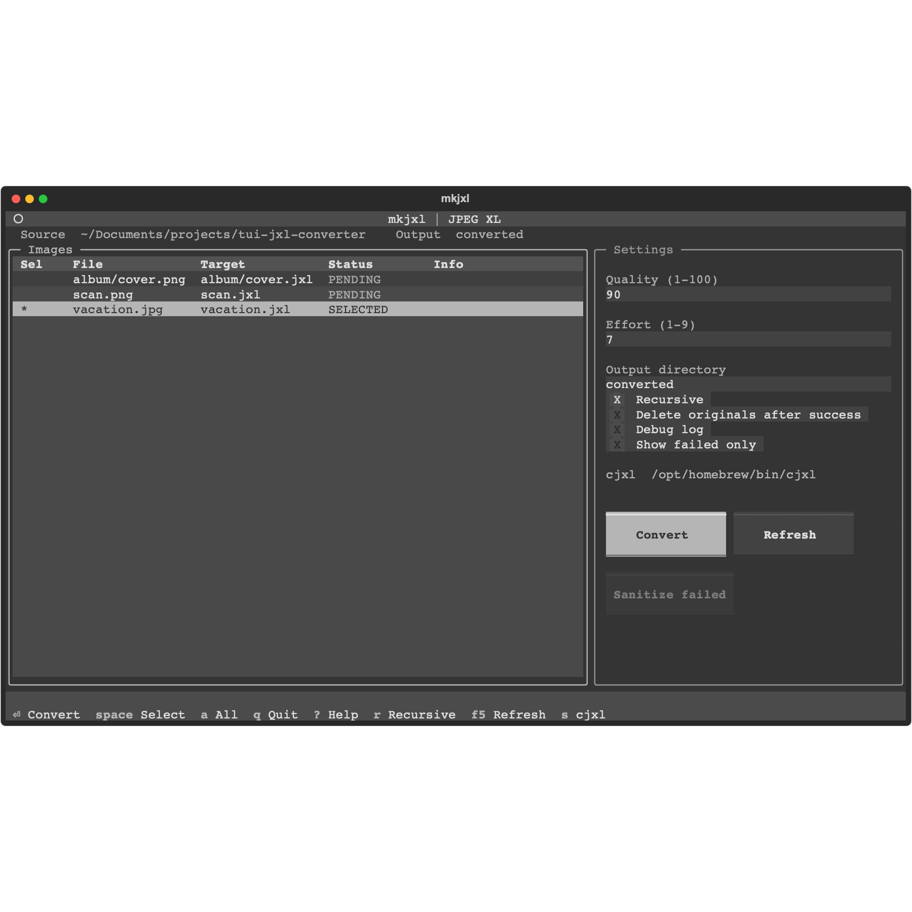

# mkjxl




A terminal app for batch converting images to JPEG XL. It is a front end for `cjxl` from [libjxl](https://github.com/libjxl/libjxl).

You pick files, set quality and effort, and watch the batch run without the UI locking up.

## Install

You still need `cjxl` on your PATH. The app does not install it for you. If it is missing, mkjxl shows the exact command for a package manager it can see. Copy puts that command on the clipboard. macOS Terminal often ignores that request. If paste is empty, select the command in the box and copy it from the terminal.

### Download a release

Prebuilt programs are attached to [GitHub Releases](https://github.com/Gradipoo/tui-jxl-converter/releases) when a version tag such as `v1.0.0` is pushed.

| File | System |
| --- | --- |
| `mkjxl-linux-x86_64` | Linux, 64-bit |
| `mkjxl-windows-x64.exe` | Windows, 64-bit |
| `mkjxl-macos-arm64` | macOS, Apple Silicon |

The download does not include `cjxl`. Install that separately (see below), then run the program.

The Linux file is built on GitHub's current Ubuntu runner, so it needs a similarly recent glibc. Older distributions should use pipx or uv instead.

The macOS build is not signed or notarized. The first open is blocked until you allow it:

1. In Finder, right-click `mkjxl-macos-arm64` and choose Open, then Open again.
2. Or, in Terminal: `xattr -d com.apple.quarantine mkjxl-macos-arm64`

Windows SmartScreen may warn on the first launch because the file is not signed. Choose More info, then Run anyway.

Intel Macs are not in the release build. Use pipx or uv on those machines.

Make the Linux and macOS files executable (`chmod +x`) if the download did not keep that bit.

### pipx or uv

```bash
pipx install git+https://github.com/Gradipoo/tui-jxl-converter.git
```

```bash
uv tool install git+https://github.com/Gradipoo/tui-jxl-converter.git
```

### From source

```bash
git clone https://github.com/Gradipoo/tui-jxl-converter.git
cd tui-jxl-converter
python -m venv .venv
source .venv/bin/activate
pip install -e .
mkjxl
```

On Windows, activate with `.venv\Scripts\activate`.

## cjxl

| System | Package manager | Command |
| --- | --- | --- |
| macOS | Homebrew | `brew install jpeg-xl` |
| Debian, Ubuntu | apt | `sudo apt-get install -y libjxl-tools` |
| Fedora | dnf | `sudo dnf install -y libjxl-utils` |
| Arch | pacman | `sudo pacman -S --noconfirm libjxl` |
| openSUSE | zypper | `sudo zypper --non-interactive install libjxl-tools` |
| Windows | winget | `winget install -e --id libjxl.libjxl --accept-package-agreements --accept-source-agreements` |
| Windows | Scoop | `scoop install libjxl` |

Chocolatey does not publish a libjxl package. Use winget or Scoop there.

If `cjxl` is installed somewhere odd, point at it with `MKJXL_CJXL=/path/to/cjxl`.

## Sanitize

Failed files can be rewritten as a plain PNG and tried again. That step uses Pillow, which is installed with mkjxl. ImageMagick (`magick`) is optional, and only used when Pillow cannot read the file. On Windows, the system `convert.exe` is not ImageMagick and is ignored.

## Usage

```bash
mkjxl
mkjxl /path/to/images
```

New to mkjxl? Read the [getting started guide](docs/GUIDE.md).

The default output folder is `./converted`, relative to the directory you started in. Clear the output field to write each `.jxl` next to its source file.

Deleting originals is off until you turn it on. The app asks before a batch that will delete sources, and it only deletes a file after `cjxl` succeeds. Keep a backup if the files matter.

## Keys

| Key | Action |
| --- | --- |
| Up/Down, `j`/`k` | Move |
| `g` / `G` | Top / bottom |
| PageUp / PageDown | Page |
| Space, or click a row | Select or clear that file |
| `a` / `A` | Select all visible files / select none |
| Enter | Convert the selected files |
| `Q` | Focus quality (1-100, default 90) |
| `E` | Focus effort (1-9, default 7) |
| `r` | Recursive on or off |
| `d` | Delete originals on or off |
| `o` | Focus the output directory |
| `f` | Show failed files only |
| `b` | Debug log on or off |
| `S` | Sanitize failed files and retry |
| `F5` | Refresh the file list |
| `s` | Show the `cjxl` install command, or report the path if `cjxl` was found |
| `?` | Key list |
| `q` | Quit. Asks first if a conversion is still running |

`q` quits. Shift+Q focuses quality. The mouse works in Windows Terminal, and in macOS and Linux terminals that support it.

JPEG files try a lossless JPEG transcode first. If that fails, `cjxl` runs again with the quality setting. Other files, and anything that was sanitized, use the quality setting directly.

## Output paths

- Default: `./converted/`.
- With a custom directory and recursive mode off, every file lands in that one directory.
- With a custom directory and recursive mode on, folders are mirrored. `source/album/cover.png` becomes `output/album/cover.jxl`.
- Blank output: the `.jxl` is written next to the source.
- If the target name already exists, or another file in the same batch wants it, the new file is `name-1.jxl`, then `name-2.jxl`, and so on.

## Debug log

Press `b` to append a log to `jxl_converter_debug.txt` in the directory where you started mkjxl.

## Troubleshooting

- **cjxl was not found.** Press `s`. Copy the command for the package manager on your machine, run it, then press `s` again.
- **The window looks cramped.** Widen the terminal. Below 100 columns the settings sit under the file list.

## License

Copyright (C) 2025-2026 Gradipoo.

GNU General Public License v3.0. You can use, change, and share this program. If you distribute a modified version, or a program that includes this code, that program must also be under GPLv3 and you must offer the source. See [LICENSE](LICENSE).
